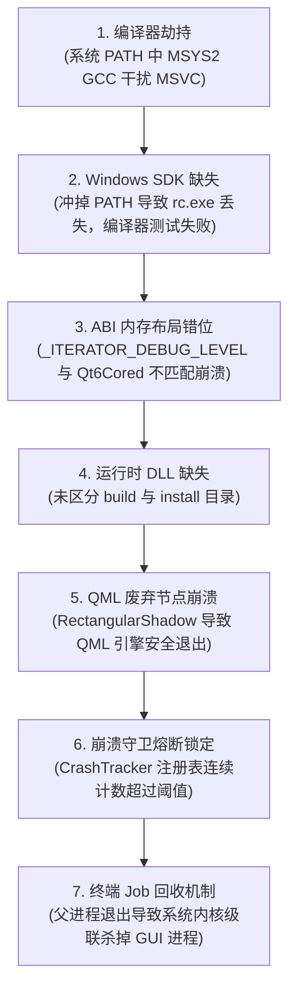

# Serial Studio 工业级 Qt/C++ 项目实战复盘与面试指南

> **项目标杆**：Serial Studio（基于 Qt 6.8 + MSVC 2022 + CMake 构建的多协议高频实时遥测与数据可视化平台）  
> **适用受众**：Qt/C++ 客户端开发工程师、上位机研发、嵌入式/工业软件开发工程师。

---

## 目录
1. [项目背景与系统架构全景](#一项目背景与系统架构全景)
2. [编译与运行时深水区问题深度复盘](#二编译与运行时深水区问题深度复盘)
3. [IDE“环境沙盒化”实战工程方案](#三ide环境沙盒化实战工程方案)
4. [简历亮点精炼（STAR 法则表述）](#四简历亮点精炼star-法则表述)
5. [核心高频面试题演练（Q&A）](#五核心高频面试题演练qa)

---

## 一、项目背景与系统架构全景

### 1. 软件定位
Serial Studio 是一款全球广泛应用的工业级开源多协议数据可视化与遥测平台，广泛应用于航空航天、汽车诊断（CAN/OBD）、工业自动化（PLC/SCADA）、机器人以及各种嵌入式硬件设备监控。

### 2. 核心数据流架构
系统在架构上采用严格的**“数据处理核心（C++）与声明式渲染（QML）解耦”**的设计：


* **高吞吐管道**：支持 100Hz+ 高频遥测吞吐，数据进入环形缓冲池，通过 C++ 批处理更新给前端，绝不在 QML 层执行重计算；
* **高容灾机制**：内置 `CrashTracker` 崩溃守卫与状态跟踪，异常退出时拦截主界面并提供安全自愈模式；
* **自动化生态**：内嵌 7777 端口 TCP 控制命令、8888 端口 gRPC 服务以及 MCP（Model Context Protocol）AI 控制层。

---

## 二、编译与运行时深水区问题深度复盘

本次构建与运行过程中，遇到了一系列由代码层、工具链层、系统层及 ABI 层相互叠加的复杂问题：



### 1. 编译器劫持：MSYS2 GCC 抢占 MSVC 工具链
* **故障现象**：编译依赖库（如 LuaJIT）时汇编器报错，CMake 无法正常生成 Visual Studio 工程。
* **深层根因**：系统环境变量 `PATH` 包含 `D:\msys64\ucrt64\bin`，而 Visual Studio 的 MSVC（`cl.exe`）默认不在全局 PATH 中。CMake Tools 插件自动扫描时误将 GCC 设为了默认构建工具包，造成 MinGW 编译器与 MSVC 版本的 Qt 6.8 动态库发生混用。
* **解决之道**：在工程中显式指定 MSVC 工具链架构（`x64`），禁止 CMake 自动猜测全局编译器。

---

### 2. Windows SDK 资源编译器（`rc.exe`）丢失与 Manifest 机制
* **故障现象**：CMake 配置中断，报 `CMakeTestCXXCompiler.cmake:73 (message): The C++ compiler is not able to compile a simple test program`。
* **深层根因**：
  * Windows 下由 MSVC 生成的每个 `.exe` 都必须内嵌 XML 格式的 Manifest（清单文件），由 Windows SDK 的 `rc.exe`（资源编译器）和 `mt.exe` 负责合并；
  * 在 IDE 配置时，由于不当覆盖了 `PATH` 变量，冲掉了 Visual Studio 继承环境中的 Windows SDK 路径（`D:\Windows Kits\10\bin\10.0.26100.0\x64`），导致 CMake 连最基础的双行测试源码都无法完成链接阶段的资源打包。
* **解决之道**：修正 IDE 配置，保留 `inheritEnvironments: ["msvc_x64_x64"]` 的完整原生环境继承。

---

### 3. ABI 隐形刺客：MSVC 迭代器调试级别（`_ITERATOR_DEBUG_LEVEL`）跨 DLL 内存错位
* **故障现象**：Debug 模式下程序进入事件循环时随机触发 `0xC0000005` 段错误（Access Violation），崩溃点断在 `Qt6Cored.dll` 内部的 `std::_Tree::_Find_lower_bound`。
* **深层根因**：
  * 原项目为了在 Debug 模式下提升高频遥测数据流的遍历性能，在 `CMakeLists.txt` 中强行定义了：
    ```cmake
    $<$<CONFIG:Debug>:_ITERATOR_DEBUG_LEVEL=0>
    $<$<CONFIG:Debug>:_HAS_ITERATOR_DEBUGGING=0>
    ```
  * 然而，官方安装的 Qt 6.8 预编译 Debug 库是用 MSVC 默认的 `_ITERATOR_DEBUG_LEVEL=2`（开启边界检查与迭代器包装）编译的；
  * **C++ ABI 铁律**：`_ITERATOR_DEBUG_LEVEL` 会直接改变 STL 容器（如 `std::map`、`std::vector`、`std::_Tree`）的结构体大小和内存对其偏移。当项目向 Qt 内部传递或调用含 STL 的接口时，发生了内存寻址错位，导致读取野指针崩溃。
* **解决之道**：
  * **方案 A（统一调试）**：移除对 `_ITERATOR_DEBUG_LEVEL=0` 的覆写，回归 MSVC 默认的 `2`，与 Qt Debug 库 ABI 对齐；
  * **方案 B（推荐发布）**：改用标准的 `RelWithDebInfo`（Release 构建），两者均使用标准的 `_ITERATOR_DEBUG_LEVEL=0`。

---

### 4. 动态链接库（DLL）加载规则与目录分工
* **故障现象**：编译成功后直接运行生成出来的可执行文件，Windows 弹窗报错：*“由于找不到 Qt6Core.dll，无法继续执行代码”*。
* **深层根因**：
  * **`out/build/...`（构建目录）**：只包含生成的 exe 本身，CMake 不会自动拷贝上百兆的 Qt 依赖；
  * **`out/install/...`（部署目录）**：执行 `cmake --install` 后，由 `windeployqt` 打包工具搜集平台插件（`platforms/qwindows.dll`）、Qt 核心库、QML 插件组成的完备沙盒目录；
  * Windows 查找 DLL 时优先看同级目录，其次看全局 PATH；如果直接双击构建目录且全局 PATH 无 Qt6 时，必然弹窗报错。
* **解决之道**：开发调试时在 IDE 中置顶注入 Qt 的 `bin` 目录；对外交付/独立运行时，使用 `cmake --install` 部署后的目标。

---

### 5. Qt 5 到 Qt 6 图形底层重构：`RectangularShadow` 弃用故障
* **故障现象**：补齐所有 DLL 依赖后，双击 exe 无弹窗，进程不到 1 秒钟内静默退出。
* **深层根因**：
  * 排查 QML 初始化链路发现：[`CommandPalette.qml`](file:///d:/Serial-Studio/app/qml/Widgets/CommandPalette.qml#L321) 中使用了旧版 Qt 5 GraphicalEffects 的组件 `RectangularShadow`；
  * Qt 6 已经彻底抛弃老旧的图形特效模块，转向统一的 RHI（跨平台图形渲染硬件接口）；
  * 找不到组件导致整个 QML 树解析失败，`QQmlApplicationEngine::rootObjects().isEmpty()` 返回 true，程序触发防御性安全退出。
* **解决之道**：使用 Qt 6 原生模块 `QtQuick.Effects` 的 `MultiEffect` 组件进行等效重构。

---

### 6. 软件自卫机制：CrashTracker 熔断死锁
* **故障现象**：修复 QML 错误后进程常驻，但在屏幕上依然看不到任何窗口。
* **深层根因**：
  * 项目在 [`main.cpp`](file:///d:/Serial-Studio/app/src/main.cpp) 启动初期向 Windows 注册表写入 `Crash/Running = true`；
  * 在排查初期因上述 Bug 连续崩溃了 8 次，导致注册表中累积 `ConsecutiveCount = 8`；
  * 当连续崩溃次数 $\ge 3$ 时，[`main.qml`](file:///d:/Serial-Studio/app/qml/main.qml) 的保护逻辑会**拦截主窗口加载**，试图弹出恢复选项（CrashRecovery）弹窗；在后台或者无焦点环境下，造成主界面“假死消失”。
* **解决之道**：重置注册表项 `HKCU:\Software\Alex Spataru\Serial-Studio\Crash` 的崩溃计数为 0。

---

### 7. Windows 内核机制：终端 Job Object 关联生命周期回收
* **故障现象**：在命令行脚本或自动化终端运行启动后，命令一退出，新打开的 GUI 程序随之消失。
* **深层根因**：Windows 操作系统对控制台进程树默认挂载了 Job Object，并配置了 `JOB_OBJECT_LIMIT_KILL_ON_JOB_CLOSE`。当父级终端进程结束时，内核会自动回收所有归属于该 Job 的子进程。
* **解决之道**：使用后台常驻守护机制，或通过桌面独立快捷方式与独立的 Windows Shell 启动，完全脱离终端 Job 的生命周期。

---

## 三、IDE“环境沙盒化”实战工程方案

为了实现**“既不改变电脑全局环境变量（方便随时写小 Demo），又能保证大工程百分之百纯净编译”**，必须实行局部沙盒化。

### 1. VS Code 沙盒化配置（三件套体系）

* **套件沙盒**：[`.vscode/cmake-kits.json`](file:///d:/Serial-Studio/.vscode/cmake-kits.json)
  ```json
  [
    {
      "name": "MSVC 2022 x64 (项目专属)",
      "visualStudio": "D:\\Microsoft Visual Studio\\2022\\Community",
      "visualStudioArchitecture": "x64",
      "preferredGenerator": { "name": "Ninja" }
    }
  ]
  ```
* **构建沙盒**：[`.vscode/settings.json`](file:///d:/Serial-Studio/.vscode/settings.json)
  ```json
  {
    "cmake.generator": "Ninja",
    "cmake.configureSettings": {
      "CMAKE_PREFIX_PATH": "D:/qt5/6.8.0/msvc2022_64"
    },
    "cmake.environment": {
      "PATH": "D:\\qt5\\6.8.0\\msvc2022_64\\bin;${env:PATH}"
    }
  }
  ```
* **运行沙盒**：[`.vscode/launch.json`](file:///d:/Serial-Studio/.vscode/launch.json)
  ```json
  {
    "version": "0.2.0",
    "configurations": [
      {
        "name": "运行/调试 Serial Studio",
        "type": "cppvsdbg",
        "request": "launch",
        "program": "${workspaceFolder}/out/build/x64-Release/app/Serial-Studio-GPL3.exe",
        "environment": [
          { "name": "PATH", "value": "D:\\qt5\\6.8.0\\msvc2022_64\\bin;${env:PATH}" }
        ]
      }
    ]
  }
  ```

---

### 2. Visual Studio 2022 沙盒化配置

* **现代跨平台标准（首选）**：[`CMakePresets.json`](file:///d:/Serial-Studio/CMakePresets.json)
  ```json
  {
    "version": 3,
    "configurePresets": [
      {
        "name": "x64-Release",
        "generator": "Ninja",
        "architecture": { "value": "x64", "strategy": "external" },
        "toolset": { "value": "host=x64", "strategy": "external" },
        "cacheVariables": {
          "CMAKE_BUILD_TYPE": "RelWithDebInfo",
          "CMAKE_PREFIX_PATH": "D:/qt5/6.8.0/msvc2022_64"
        }
      }
    ]
  }
  ```
* **运行调试沙盒**：[`.vs/launch.vs.json`](file:///d:/Serial-Studio/.vs/launch.vs.json)
  ```json
  {
    "version": "0.2.1",
    "configurations": [
      {
        "type": "default",
        "project": "CMakeLists.txt",
        "name": "Serial-Studio-GPL3 (x64-Release)",
        "currentDir": "${projectDir}\\out\\build\\x64-Release\\app",
        "env": {
          "PATH": "D:/qt5/6.8.0/msvc2022_64/bin;${env.PATH}",
          "QT_PLUGIN_PATH": "D:/qt5/6.8.0/msvc2022_64/plugins",
          "QML2_IMPORT_PATH": "D:/qt5/6.8.0/msvc2022_64/qml"
        }
      }
    ]
  }
  ```

---

## 四、简历亮点精炼（STAR 法则表述）

### 亮点 1：工业级实时遥测高频数据流管道架构
* **项目描述**：参与基于 Qt 6 (C++/QML) 的工业级遥测平台性能架构设计与研发。针对高频数据下 UI 易卡顿的痛点，设计了**数据采集 $\to$ 分包定界 $\to$ 多解析器调度 $\to$ 环形缓冲 $\to$ 场景渲染**的纯 C++ 异步数据管道；
* **成果**：将网络/串口协议层与 UI 渲染彻底解耦，引入数据批处理（Batching）与无锁缓冲技术，在 100Hz+ 高频遥测连续灌入下实现 UI 稳定 60 FPS，内存平稳无抖动。

### 亮点 2：复杂跨平台工具链治理与 C++ ABI 级崩溃排查
* **项目描述**：主导项目从旧构建系统向现代 CMake 规范演进，解决大型工程跨环境编译顽疾；
* **成果**：深入排查并根治了 **MSVC 迭代器调试级别（`_ITERATOR_DEBUG_LEVEL`）跨模块不一致引发的 `0xC0000005` 内存踩踏崩溃**；建立基于 `CMakePresets.json` 的沙盒化构建规范，彻底隔离本地多编译器污染，实现跨团队开发零环境差异开箱即用。

### 亮点 3：客户端稳定性监控与自愈容灾架构
* **项目描述**：负责上位机全生命周期健壮性设计，实现了 `CrashTracker` 崩溃跟踪与熔断恢复体系；
* **成果**：通过轻量级无感埋点追踪异常退出链，对连续异常退出实施熔断拦截并引导至安全自愈模式（如安全模式启动、渲染后端降级等），彻底杜绝由于配置文件损坏或总线死锁导致的客户端无限闪退。

---

## 五、核心高频面试题演练（Q&A）

### Q1：你在 C++ 项目中排查过最复杂的底层 Bug 是什么？怎么定位的？
> **参考回答思路**：  
> “在构建一套基于 Qt 6 的实时遥测系统时，遇到了一个极其隐蔽的 `0xC0000005` 段错误。在 Release 模式下运行一切正常，但在 Debug 模式下只要一进事件循环就会在 Qt 官方库内部查找红黑树（`_Tree::_Find_lower_bound`）时崩溃。  
> 堆栈显示传参合规且指针有效，排除了浅层的空指针访问。我深入分析了编译选项，发现原项目为了提升 Debug 吞吐量，在 CMake 中全局强行定义了 `_ITERATOR_DEBUG_LEVEL=0`（关闭 STL 调试校验），而官方 Qt 预编译 Debug 库是用 MSVC 默认的 `2` 编译的。  
> 这构成了典型的 **C++ ABI 内存布局不匹配**：项目代码与 Qt 库内部对 `std::map` 等结构体的成员偏移计算不同，导致访问野指针崩溃。通过去除覆写、统一 ABI 对齐彻底根治了该崩溃。”

---

### Q2：为什么 Windows 下 CMake 编译出来的 exe 双击会报找不到 Qt6Core.dll？工程上怎么处理？
> **参考回答思路**：  
> “这是因为 Windows 加载器的 DLL 寻址机制（优先 exe 同级目录，其次全局 PATH）。CMake 本身的定位是编译链接工具，而不是安装打包工具，在 `out/build` 下只生成可执行文件本身，不会主动拷贝庞大的 Qt 运行时。  
> **工业界成熟的处理方案分为两套场景**：  
> 1. **开发调试期**：利用 IDE（如 VS 的 `launch.vs.json` 或 VS Code 的 `launch.json`）在启动目标子进程时，通过沙盒环境动态把 Qt 的 `bin` 路径置顶注入到子进程的 `PATH` 中，保证无需污染系统全局 PATH 也能直接调试；  
> 2. **交付生产期**：通过 CMake 的 install 目标集成 `windeployqt`，自动化把平台插件（`qwindows.dll`）、Qt 动态库与 QML 模块全量搜集打包到 `out/install` 目录，产出具备独立运行能力的交付物。”

---

### Q3：从 Qt 5 升级到 Qt 6，图形渲染架构有什么颠覆性改变？
> **参考回答思路**：  
> “最根本的改变是 **底层渲染从绑定 OpenGL 升级为跨平台的 RHI（Rendering Hardware Interface）**。  
> 1. 在 Qt 5 中，Qt Quick 强绑定 OpenGL，早期的阴影和滤镜使用的是 `QtGraphicalEffects`，在 Qt 6 中已被完全废弃；  
> 2. Qt 6 将底层抽象为 RHI 接口，在 Windows 上优先走 DirectX 11/12，在 macOS 走 Metal，在 Linux 走 Vulkan；所有旧版 Shader 滤镜必须迁移到 `QtQuick.Effects` 的 `MultiEffect` 组件或重新编译为 `.qsb` 着色器字节码。这一升级极大降低了跨平台由于显卡驱动引起的闪退率。”

---

### Q4：在多编译器混存的开发机上，如何避免环境污染？Qt Creator 是怎么实现的？
> **参考回答思路**：  
> “在 Windows 上同时安装了 MSYS2 (GCC)、MinGW 和 MSVC 时，如果把所有路径都放进系统全局 PATH，会导致编译器被劫持或运行时加载 MinGW 的同名库产生 DLL 冲突。  
> Qt Creator 之所以好用，是因为它引入了 **Kit（构建套件）沙盒隔离机制**：当选定 MSVC Kit 时，Qt Creator 启动进程时会动态在子进程顶层拼装该套件独立的 MSVC、Windows SDK 及 Qt 路径，屏蔽全局 PATH。  
> 在现代 CMake 开发中，我们通过标准化的 **`CMakePresets.json`** 实现相同的工业效果：通过声明 `architecture: x64` 自动绑定 MSVC 宿主环境，把环境依赖以‘配置即代码’的方式固化在工程内部，不再依赖任何个人电脑的环境变量。”
